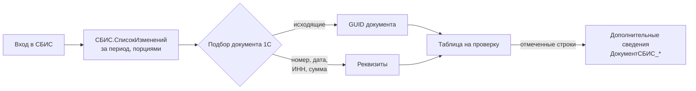

# Восстановление связей документов 1С с пакетами СБИС

Обработка для 1С:КА 2.5, 1С:ERP 2.5 и других конфигураций на БСП, которые обмениваются документами со СБИС (Saby) через модуль интеграции СБИС.

Она нужна, когда из регистра «Дополнительные сведения» случайно удалены записи `ДокументСБИС_Ид`, `ДокументСБИС_ИдВложения` и `ДокументСБИС_Статус`. Без них документ теряет связь с пакетом: в реестре пустой статус, а обмен считает, что документ в СБИС не отправлялся. Есть риск отправить его повторно.

Обработка читает пакеты из СБИС, подбирает к ним документы 1С и показывает результат на проверку. Записываются только строки, которые отметил пользователь.

## Как это работает

- **Исходящие:** идентификатор пакета, созданного из 1С, совпадает с GUID документа. Если так найти не удалось, документ ищется по номеру, дате, ИНН контрагента и организации, сумме. Номер сравнивается целиком и по последней группе цифр (`АБ-1039` и `АБ00-001039`).
- **Входящие:** номер и дата входящего документа, ИНН, сумма.
- **Связь на все документы пакета:** как при штатной отправке, связь записывается и на документ отгрузки, и на счёт-фактуру. Исправленные счета-фактуры не затрагиваются.

## Безопасность

- В СБИС обработка ничего не записывает и не отправляет. Отметку штатного обмена о последнем прочитанном событии она не меняет.
- Существующие связи не перезаписываются. Один документ не связывается с несколькими пакетами, такие случаи показываются для ручного разбора.
- Пакеты, удалённые в СБИС, и документы, помеченные на удаление, автоматически не связываются.
- При дублях свойств `ДокументСБИС_*` обработка останавливается: иначе неизвестно, какое свойство читает штатный обмен.
- Каждая запись фиксируется в журнале регистрации, событие «Восстановление связей СБИС».
- Пароль не сохраняется. Поддерживается вход с кодом подтверждения.

## Работа с формой

1. **Вход в СБИС:** логин, пароль, при необходимости код подтверждения.
2. **Что загрузить:** «Исходящие» или «Входящие» и период изменений в СБИС, затем «Загрузить и подобрать». Большой период читается порциями.
3. **Проверка и запись:** надёжные строки уже отмечены, спорные выделены цветом. Отбор по результату, ручной выбор документа из кандидатов, затем «Записать отмеченные».

Редкие параметры спрятаны под флажком «Дополнительные настройки»: дата документа, размер порции, виды документов, сервер СБИС, префикс свойств. Подробная справка встроена в обработку (кнопка «?»).

## Установка

В [Releases](../../releases) два варианта одной и той же обработки:

- **Внешняя обработка** `вт_ВосстановлениеСвязейСБИС.epf` — открыть через «Файл → Открыть» или подключить в «Дополнительные отчеты и обработки» (регистрационные данные заполнены).
- **Расширение** `ВосстановлениеСвязейСБИС.zip`: Конфигуратор → Конфигурация → Расширения конфигурации → создать расширение → «Загрузить конфигурацию из файлов» → папка `ВосстановлениеСвязейСБИС` → обновить конфигурацию базы данных. Роль — `вт_ВосстановлениеСвязейСБИС`, обработка открывается через «Все функции» или добавляется в нужную подсистему.

Требования:
- у расширения должен быть **снят безопасный режим**, иначе HTTP-запросы к СБИС запрещены;
- сервер 1С должен иметь доступ к `online.sbis.ru`;
- для записи нужны права на регистр «Дополнительные сведения»;
- связи СБИС в базе хранятся в дополнительных сведениях (`ПланВидовХарактеристик.ДополнительныеРеквизитыИСведения`, `РегистрСведений.ДополнительныеСведения`).

## Перед запуском в рабочей базе

- Сделайте резервную копию.
- Не открывайте штатную обработку СБИС в копии базы под рабочим аккаунтом: она может сдвинуть общую отметку обновления статусов, и рабочая база пропустит изменения.
- Начните с короткого периода и 2–3 документов, проверьте статус и связь в реестре СБИС.
- Входящие восстанавливайте только если они раньше действительно были связаны с СБИС: иначе будут созданы новые связи.

## Структура

| Путь | Что это |
|---|---|
| `ВосстановлениеСвязейСБИС/` | Расширение в формате выгрузки в файлы, префикс `вт_`, режим совместимости 8.3.20 |
| `external/` | Внешняя обработка в формате выгрузки в файлы |
| `src/FormModule.bsl` | Модуль формы: интерфейс, подбор, запись, работа с API СБИС (JSON-RPC) |
| `src/ObjectModule.bsl` | Регистрационные данные для «Дополнительных отчетов и обработок» |
| `src/Help.html` | Справка |

Форма создаётся программно, поэтому модуль формы содержит весь код обработки.

## Ограничения

- Не восстанавливаются `ДокументСБИС_Расхождение` и `ДокументСБИС_СтатусГос`: они появятся при следующем изменении пакета.
- Записи, ссылающиеся на удалённые элементы плана видов характеристик, нужно перепривязывать отдельно.

## Лицензия

MIT
